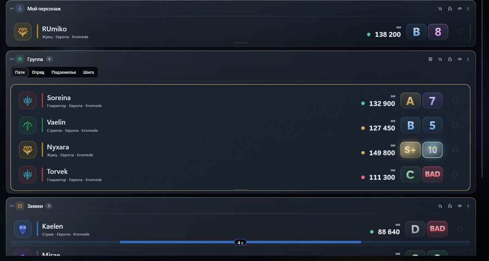
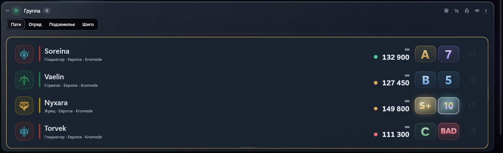
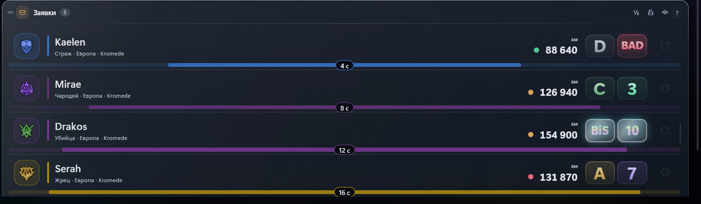
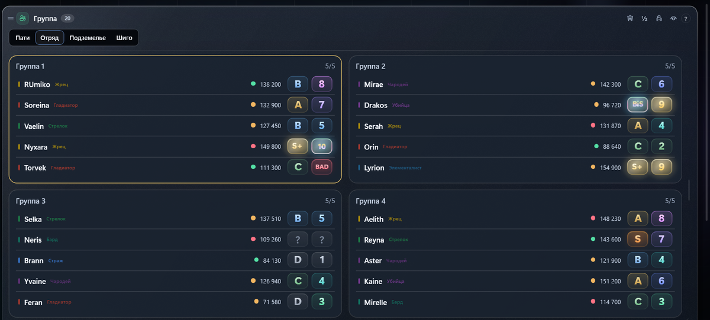
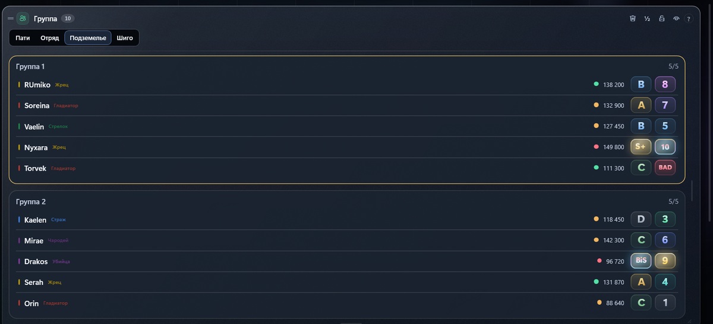
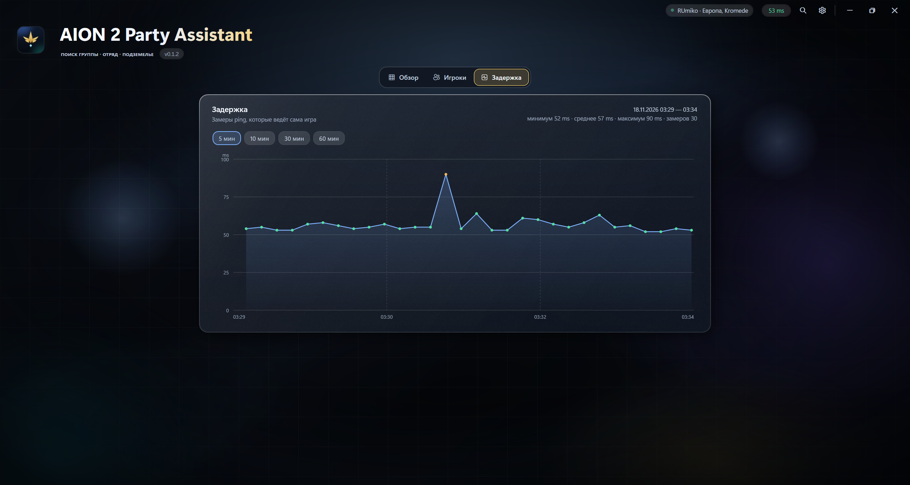
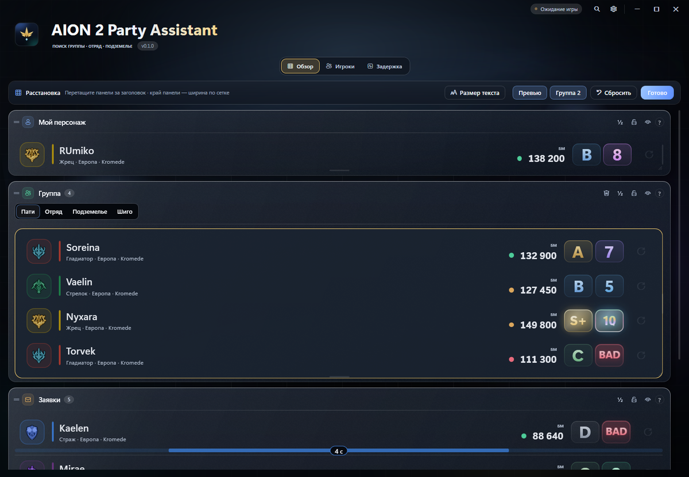
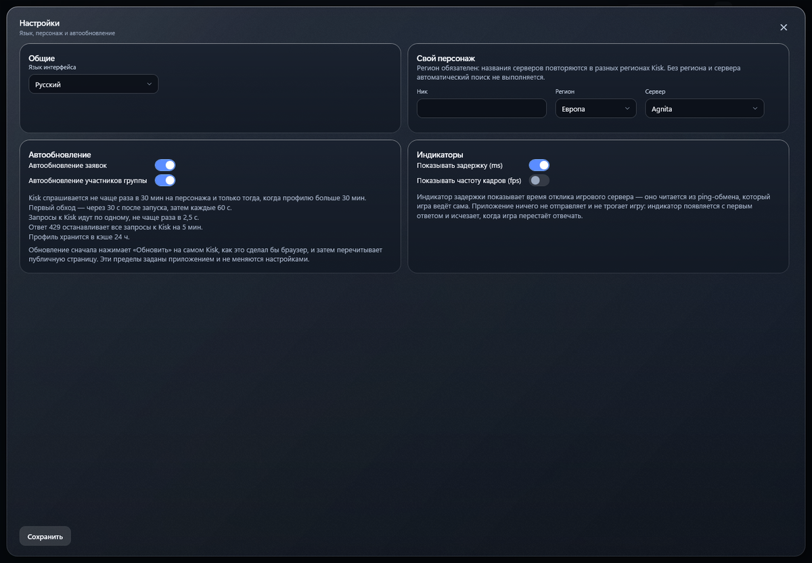

# AION 2 Party Assistant

**English version:** [docs/en/README.md](docs/en/README.md).

Помощник для поиска группы в **AION 2** (Windows, глобальные серверы EU/NA).
Приложение смотрит на уже идущий бой глазами игры: само определяет вашего
персонажа, состав группы, заявки и приглашения, находит каждого игрока на
публичном сайте [Kisk](https://kisk.app) и раскладывает класс, БМ, ГИР и
давность профиля по карточкам — чтобы решение «принять или нет» занимало
секунду, а не полминуты.

Это **не** DPS-метр. В приложении нет счётчиков урона, оверлеев, чтения памяти
игры, отправки пакетов и авто-принятия заявок. Всё, что оно знает об игре, оно
читает из копий сетевых пакетов, которые операционная система уже получила.

> На скриншотах — демонстрационные данные из режима предпросмотра. Ники
> реальных игроков в документации не публикуются.

**Скачать:** [Releases](https://github.com/Dikomillo/Aion2PartyAssistant/releases/latest).
Что нового в каждой версии — в [`docs/releases/`](docs/releases/).

## Главное

Три вещи, ради которых приложение и сделано; всё остальное их дополняет.

### Отметки игроков — BAD и 1–10

Это главная фишка. Каждый, кто вам важен, получает **вашу собственную отметку**:
`BAD` красным или 1–10, где 9 подсвечена, а 10 переливается. Отметка ставится в
окне персонажа в один клик и стоит на карточке **раньше, чем ответит Kisk**:
знакомого с `BAD` видно сразу, сильного — тоже, и решение не приходится
принимать вслепую. Отметки не теряются между запусками, собираются на отдельной
странице «Игроки» и обновляются одной кнопкой.

### Очередь заявок целиком

Игра показывает заявки по одной; здесь **вся очередь сразу** — в порядке
прихода, со временем на ответ и с сервером заявителя, прочитанным из самой
записи. Видно, кого принимать первым, не перелистывая карточки в игре.
Принимаете и отклоняете по-прежнему в игре: приложение только показывает и
никогда не отвечает за вас.

### ГИР, БМ и класс с Kisk — до нажатия «Принять»

На каждой карточке: **БМ (боевая мощь)**, **ГИР (gear score)**, класс со
значком и цветом, давность профиля и состояние запроса к Kisk. Профиль
подтягивается из [Kisk](https://kisk.app) автоматически по серверу заявителя,
кэшируется на сутки и обновляется сам, когда устаревает, — в общей очереди, не
чаще одного запроса в 2,5 секунды. Чего Kisk не сказал, остаётся пустым:
приложение ничего не придумывает.

## Что умеет

### Свои персонаж, группа и заявки — сами

Приложение определяет входящие записи игры пассивно, через Npcap, и сразу
показывает то, что видит лидер группы: кто в пати, кто подал заявку, кто
приглашает. Работает и через игровые ускорители, которые заворачивают
соединение в локальный прокси.

Карточка каждого игрока — это класс (значок из самой игры и цвет), ник, БМ и
ГИР с Kisk, состояние запроса к Kisk и давность профиля. Данные, которых нет,
остаются пустыми: приложение ничего не придумывает.

### Заявки: вся очередь сразу

Игра показывает заявки по одной, а здесь видна вся очередь сразу — в том
порядке, в каком они пришли, со временем на ответ. Решение (принять или
отклонить) по-прежнему принимается в игре: приложение только показывает, кто и
откуда, и никогда не отвечает за вас. Сервер заявителя читается из самой
записи, поэтому Kisk опрашивается по нужному миру, даже если заявка пришла с
другого сервера.

### Отметки: BAD и 1–10

На каждой карточке стоит ваша собственная отметка игрока: `BAD` красным или
1–10, где 9 подсвечена, а 10 переливается. Ставится она в окне персонажа,
которое открывается кликом по любой карточке: шкала, «Снять отметку» и ссылка
на Kisk. Так заявитель, с которым вы уже имели дело, виден до того, как Kisk
ответит: знакомого с отметкой `BAD` можно не брать сразу, а сильного игрока —
брать, не дочитывая. Отметки хранятся в `party.db` и остаются между запусками.

### Игроки: все, кого вы отметили

Страница «Игроки» собирает отмеченных персонажей в таблицу: отметка, класс,
БМ, ГИР, сервер и когда Kisk последний раз отвечал. Есть фильтры по классу,
серверу и отметке, поиск по нику, сортировка по столбцам и «Обновить всех на
Kisk»: кнопка обновляет всех, кого показывает текущий фильтр, показывает ход
и останавливается, если Kisk попросил подождать.

### Отряд: четыре группы

Рейд рисуется как окно рейда в игре: четыре группы по пять мест, ваша группа
обведена золотом. Место в группе — то, что сказала игра; кто ещё не
определён, стоит отдельной строкой и не приписывается к первой группе.

### Подземелье: комната поиска группы

Пока вы собираете пати через поиск группы, приложение показывает саму комнату:
кто уже принят, в какой группе и на каком месте. Комната — это всегда две
таблицы по пять мест; вторая группа появляется, как только в неё кто-то встал.

### Рядом: поле Шиго (бета)

Панель группы переключается на «Шиго» — список персонажей, которых игра
загрузила вокруг вас в поле или на ивенте. По каждому видно ник, сервер (его
называет сама игра), класс и гильдию; клик открывает окно персонажа с отметкой
и ссылкой на Kisk. Само приложение Kisk для них не опрашивает: это список
«кто со мной», а не профили. Живёт он только до конца текущего соединения:
после перехода начинается заново, а при запуске всегда пуст. Пометка «бета» —
потому что разбор записи ещё не закрыт: какой из двух миров в плашке имени
собственный, пока не решено.

### Задержка (ms) и частота кадров (FPS)

В заголовке два индикатора. `ms` — время отклика игрового сервера, взятое из
ping-обмена, который игра ведёт сама: чтобы его измерить, ничего не
отправляется, и индикатор исчезает, если игра перестала отвечать. Клик по нему
открывает страницу с графиком за 5, 10, 30 или 60 минут.

`FPS` — частота, с которой рисует сама игра: её видно по кадрам, которые
Windows и так получает при отрисовке, память игры при этом не читается.
Индикатор по умолчанию выключен — Windows требует для него прав
администратора, и настройки объясняют это до включения.

Индикатор работает, когда приложение запущено от администратора. Установщик
помечает оба ярлыка — в меню «Пуск» и на рабочем столе — отметкой «запускать
от имени администратора», поэтому настраивать вручную ничего не нужно:
Windows спросит подтверждение при запуске ярлыка (если на компьютере включён
контроль учётных записей) — это и есть повышение прав. Если вы ставили эту
галочку вручную по инструкции версии 0.1.6, обновление её снимет: отметка на
ярлыке делает то же самое.

### Поиск по нику (Ctrl+K)

Любого персонажа можно найти вручную: ник, регион и сервер — профиль Kisk
приходит в том же виде, что и карточки. Поиск идёт через общую очередь с
ручным приоритетом.

### Расстановка под себя

Панели двигаются за заголовок, край задаёт ширину по сетке, есть превью,
которое заполняет панели примерами, и общий масштаб текста. Расстановка и
размер окна запоминаются сами.

### Настройки

Язык (русский / английский, без перезапуска), свой ник и сервер, два
переключателя автообновления и два индикатора. Все ограничения Kisk (очередь,
таймауты, пауза при 429, кэш) заданы приложением и показаны на экране как
текст — их нельзя «ускорить» настройкой.

## Установка

1. Скачайте `Aion2PartyAssistant-<версия>-setup.exe` из раздела **Releases** и
   запустите его (Windows спросит подтверждение администратора).
2. Установщик предлагает папку `D:\Aion2PartyAssistant`; её можно поменять на
   любую свою — только не на системную, вроде `Program Files`: приложение хранит
   настройки и базу рядом с собой, и туда обычному пользователю писать нельзя.
   При обновлении в поле уже стоит текущая папка. Ярлык появляется в меню
   «Пуск», ярлык на рабочем столе по желанию.
3. Запустите игру и войдите в мир, затем запустите приложение: шапка заполнится
   сама. При желании укажите свой ник, регион и сервер в настройках.

Установщик не подписан, поэтому SmartScreen может предупредить о запуске —
это ожидаемо для бесплатной сборки без сертификата.

### Что нужно

- Windows 10 или 11, x64.
- [Npcap](https://npcap.com/) с поддержкой loopback (галочка в установщике
  включена по умолчанию) — для определения игры в реальном времени. Без Npcap
  приложение запускается и работает с ручным поиском, но группу и заявки не
  увидит.
- Права администратора могут понадобиться для захвата пакетов и нужны для
  индикатора частоты кадров. Ярлыки, которые создаёт установщик, уже помечены
  «запускать от имени администратора» — включать что-либо вручную не нужно.

## Обновление и удаление

- Новая версия ставится поверх старой; папка `data` не трогается, все
  настройки и кэш остаются. Понизить версию установщик не даст.
- Удаление убирает программу, ярлыки и запись в списке приложений, но **не**
  `D:\Aion2PartyAssistant\data` — она остаётся вместе с настройками, базой и
  логами. Для полной очистки папку нужно удалить вручную.
- Npcap установщик не содержит (для его распространения нужна лицензия OEM), а
  только предлагает скачать.
- При запуске приложение спрашивает, не вышла ли новая версия. Если вышла, над
  страницей появляется строка с номером версии и кнопкой «Скачать» — установка
  остаётся за вами. Версию, которую проект пометил критической, приложение
  ставит само: скачивает установщик, сверяет его контрольную сумму, запускает
  и закрывается; Windows спросит разрешение, настройки и кэш сохраняются.
- Наведите на версию под заголовком: она скажет, последняя ли она, и назовёт
  новую, если проверка её нашла.
- В строке заголовка, сразу после настроек, стоят знаки проекта: GitHub ведёт на
  страницу проекта (рядом — сколько у него звёзд), а знак Boosty открывает окно
  поддержки — в нём написано, зачем она нужна, и лежит QR-код страницы
  `boosty.to/dikomillo`.
- Окно поддержки появляется при каждом запуске поверх открытой вкладки. Его
  можно закрыть кнопкой «Не сейчас», щелчком мимо окна или клавишей Esc;
  галочка «Больше не показывать до перезапуска» убирает его до конца текущего
  запуска (на следующий оно снова появится), а если её не отмечать — окно
  вернётся через два часа.

## Где лежат данные

Всё — в подпапке `data` рядом с программой (по умолчанию
`D:\Aion2PartyAssistant\data\`):

| Файл | Что это |
| --- | --- |
| `settings.json` | настройки, версия схемы, резервная копия `.bak` при повреждении |
| `party.db` | SQLite (WAL): заявки, участники, кэш Kisk, отметки игроков |
| `party-roster.json` | последний состав группы, если включено восстановление |
| `own-character.json` | последний свой персонаж (только как фильтр по нику) |
| `latency-history.json` | ответы пинга за последний час — чтобы график не пустел после перезапуска |
| `logs\app-{дата}.log` | журнал Serilog, хранится 7 дней |

## Приватность и безопасность

- Игра не трогается: память не читается, код не внедряется, пакеты не
  отправляются, поверх игры ничего не рисуется.
- Перехват пассивный: приложение читает копии TCP-пакетов через Npcap и не
  имеет пути на запись.
- Kisk опрашивается по публичным страницам, честным User-Agent, не чаще одного
  запроса в 2,5 с, с кэшем на 24 часа, паузой на 5 минут при ответе 429 и
  ограничением автообновления (не чаще 30 минут на персонажа).
- Журнал не содержит HTML-страниц и токенов; в документацию не попадают ники
  и идентификаторы других игроков.

## Известные ограничения

- Состав группы игра присылает только при изменении, поэтому после запуска
  приложения панель может оставаться пустой, пока кто-то не войдёт или не
  выйдет; текст пустого состояния говорит об этом же.
- Свой персонаж не восстанавливается с прошлого запуска: карточка появляется,
  когда игра сама пришлёт запись о входе или смене зоны.
- Авто-принятие и авто-отклонение заявок отсутствуют намеренно: решение всегда
  за игроком.

## Исходный код

Приложение распространяется только собранным установщиком; исходники проекта
не опубликованы. Сборки и заметки о каждой версии —
[Releases](https://github.com/Dikomillo/Aion2PartyAssistant/releases)
и [`docs/releases/`](docs/releases/).

## English

Полное описание на английском — [docs/en/README.md](docs/en/README.md); скриншоты
там те же, с русским интерфейсом.

## Атрибуция

Значки классов в интерфейсе нарисованы для этого проекта. Код и графика здесь
свои: сторонние программы, изученные при исследовании протокола, в сборку не
входят и её не требуют.
