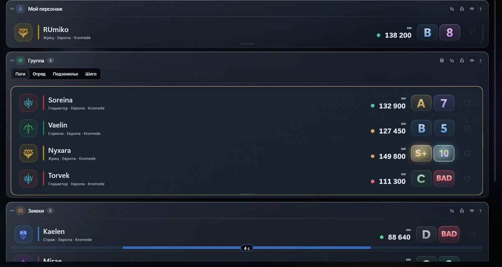
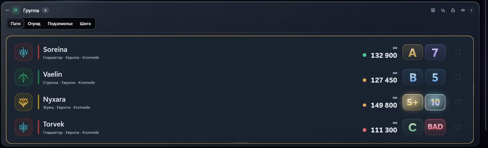
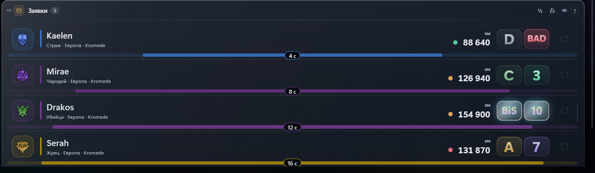
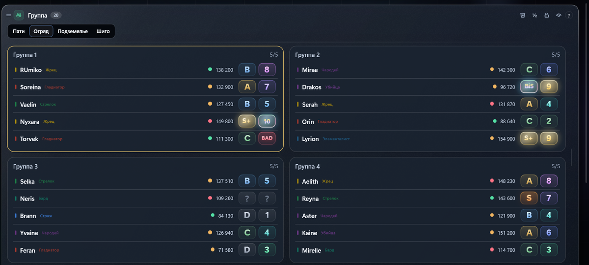
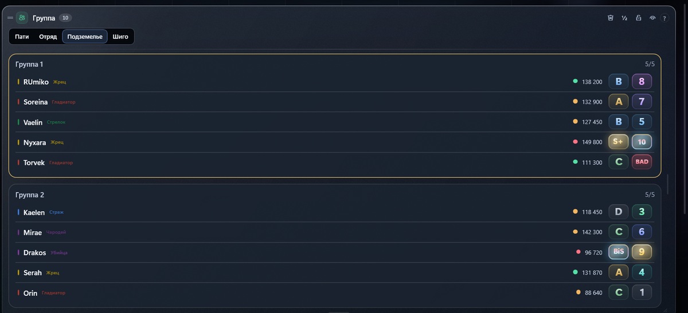
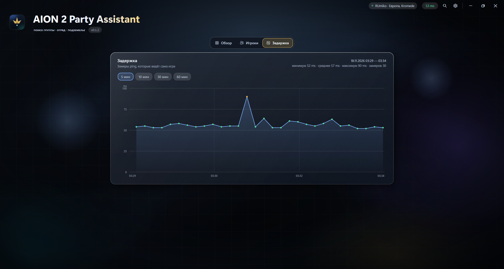
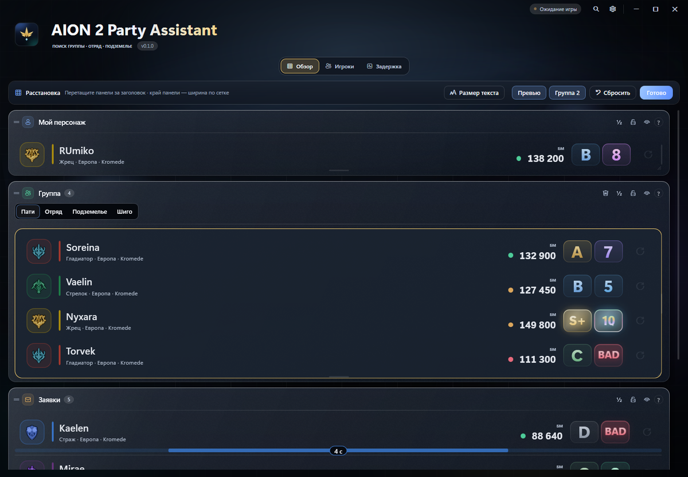
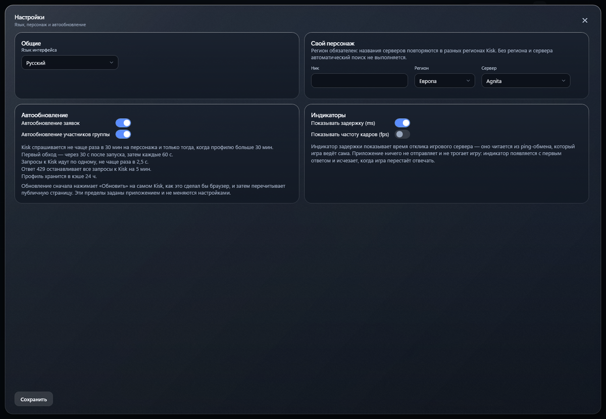

# AION 2 Party Assistant

**Русская версия:** [../../README.md](../../README.md).

A party-finder helper for **AION 2** (Windows, global EU/NA servers). The app
watches the fight that is already going on through the game's own eyes: it
detects your character, your party, applications and invitations by itself,
looks each player up on the public [Kisk](https://kisk.app) site and lays out
class, combat power, gear score and profile freshness on the cards — so that
"accept or not" takes a second instead of half a minute.

This is **not** a DPS meter. There are no damage counters, no overlays, no
memory reads, no packets sent and no automatic accepting of applications.
Everything it knows about the game it reads from copies of the network packets
the operating system has already received.

> The screenshots show demonstration data from the preview mode. Real players'
> nicknames are not published in the documentation.

**Download:** [Releases](https://github.com/Dikomillo/Aion2PartyAssistant/releases/latest).
What changed in each version is in [`docs/releases/`](../releases/).

## The essentials

Three things the app exists for; everything else builds on them.

### Player marks — BAD and 1–10

This is the flagship. Everyone who matters to you gets **your own mark**: `BAD`
in red, or 1–10, where 9 is highlighted and 10 shimmers. The mark is set in the
character window with one click and stands on the card **before Kisk answers**:
a known `BAD` is visible at once, and so is a strong player, so the decision is
never made blind. Marks survive restarts, are collected on the Players page and
refreshed with one button.

### The whole application queue at once

The game shows applications one at a time; here **the whole queue** is visible —
in arrival order, with the time left to answer and the applicant's server read
out of the record itself. You can see whom to take first without paging through
the game's cards. Accepting and declining still happens in the game: the app
only shows, it never answers for you.

### Gear score, combat power and class from Kisk — before you press Accept

Every card carries **combat power**, **gear score**, the class with its badge
and colour, the age of the profile and the state of the Kisk request. The
profile is fetched from [Kisk](https://kisk.app) automatically by the
applicant's server, cached for 24 hours and refreshed by itself when it goes
stale — through the one shared queue, at most once every 2.5 s. What Kisk did
not say stays empty: the app invents nothing.

## What it does

### Your character, party and applications — by themselves

The app detects incoming game records passively through Npcap and immediately
shows what the party leader sees: who is in the party, who applied, who is
inviting. It also works through game accelerators that wrap the connection in a
local proxy.

Each player's card carries the class (the game's own badge and its colour), the
nickname, combat power and gear score from Kisk, the state of the Kisk request
and the age of the profile. Data that is not there stays empty: the app never
invents anything.

### Applications: the whole queue at once

The game puts applications in front of you one at a time; here the whole queue
is visible at once, in the order the applications arrived, with a countdown to
answer. Accepting and declining still happens in the game — the app only shows
who is asking and from where, and never answers for you. The applicant's server
is read out of the record itself, so Kisk is asked about the right world even
when the application comes from another server.

### Marks: BAD and 1–10

Every card carries your own mark on the player: `BAD` in red, or 1–10, where 9
is highlighted and 10 shimmers. The mark is set in the character window, which
opens with a click on any card: the scale, «Снять отметку» (clear the mark) and
a link to Kisk. An applicant you have dealt with before is therefore visible
before Kisk answers: a known `BAD` can be turned down without a second thought,
and a strong player taken without reading further. Marks are stored in
`party.db` and survive restarts.

### Players: everyone you have marked

The «Игроки» (Players) page collects the marked characters into one table: the
mark, class, combat power, gear score, server and when Kisk last answered. It
filters by class, server and mark, searches by nickname, sorts by column, and
offers «Обновить всех на Kisk» (refresh everyone on Kisk): the button refreshes
every character the current filter shows, reports its progress and stops if
Kisk asks to be left alone.

### Raid: four groups

A raid is drawn like the game's own raid window: four groups of five places,
with your group outlined in gold. A member's place is what the game stated;
anyone not yet placed stands on a separate line instead of being pushed into
group one.

### Dungeon: the party-finder room

While you are assembling a party through the party finder, the app shows the
room itself: who has been accepted, in which group and in which place. The room
is always two tables of five places; the second group appears as soon as
someone stands in it.

### Nearby: the Shigo field (beta)

The party panel switches to «Шиго» (Shigo) — the characters the game has loaded
around you in a field or at an event. For each one it shows the nickname, the
server (the game itself states it), the class and the guild; a click opens the
character window with your mark and a Kisk link. The app looks none of them up
by itself: this is a "who is with me" list, not a set of profiles. It lives only
for the current connection — after a change of place it starts over, and on
launch it is always empty. The beta tag is there because the record is not
fully settled yet: which of the two worlds in the name plate is the
character's own has not been decided.

### Latency (ms) and frame rate (FPS)

The title bar carries two chips. `ms` is the game server's response time, taken
from the ping exchange the game runs itself: nothing is sent to measure it, and
the chip disappears if the game stops answering. A click on it opens the page
with the plot for the last 5, 10, 30 or 60 minutes.

`FPS` is the rate at which the game itself draws, read from the frames Windows
already receives on present; the game's memory is never read. The chip is off by
default — Windows requires administrator rights for it, and the settings screen
explains that before the switch can be turned on.

The chip works when the application is running as administrator. The installer
marks both shortcuts — in the Start menu and on the desktop — with "run as
administrator", so nothing has to be set up by hand: Windows asks for
confirmation when the shortcut is started (if User Account Control is enabled)
— that dialog is the elevation. If you ticked that box by hand following the
0.1.6 notes, an update removes it: the shortcut already carries the same mark.

### Search by nickname (Ctrl+K)

Any character can be looked up by hand: nickname, region and server — the Kisk
profile comes back in the same shape as the cards. The search goes through the
same queue with manual priority.

### Layout of your own

Panels move by their header, a panel's edge sets its width on the grid, a
preview fills the panels with sample cards, and there is one text scale for the
whole window. The layout and the window size are remembered by themselves.

### Settings

Language (Russian / English, no restart), your own nickname and server, two
auto-refresh switches and two chips. Every Kisk limit (queue, timeouts, the 429
pause, the cache) is fixed by the application and shown on the screen as text —
no setting can make it faster.

## Install

1. Download `Aion2PartyAssistant-<version>-setup.exe` from **Releases** and run
   it (Windows will ask for administrator confirmation).
2. The setup proposes the folder `D:\Aion2PartyAssistant`; it can be changed to
   any folder of your own — just not a system one such as `Program Files`: the
   app keeps its settings and database next to itself, where an ordinary user
   cannot write. On an upgrade the field already holds the current folder. A
   shortcut goes to the Start menu, and a desktop shortcut is optional.
3. Start the game and log in, then start the app: the header fills in by
   itself. Your nickname, region and server can also be set in the settings.

The installer is not signed, so SmartScreen may warn about running it — that is
expected for a free build without a certificate.

### Requirements

- Windows 10 or 11, x64.
- [Npcap](https://npcap.com/) with loopback support (the checkbox in its
  installer is on by default) — for detecting the game in real time. Without
  Npcap the app still starts and works with manual lookup, but it will not see
  the party or the applications.
- Administrator rights may be needed for packet capture and are required for
  the frame-rate chip. The shortcuts the installer creates already carry the
  "run as administrator" mark — nothing has to be ticked by hand.

## Updating and uninstalling

- A new version installs over the old one; the `data` folder is not touched and
  every setting and cache entry stays. The installer refuses to downgrade.
- Uninstalling removes the program, the shortcuts and the entry in the list of
  apps, but **not** `D:\Aion2PartyAssistant\data` — it stays with the settings,
  the database and the logs. For a complete cleanup the folder has to be
  deleted by hand.
- Npcap is not bundled with the installer (distributing it needs an OEM
  licence); it is only offered for download.
- On launch the app asks whether a newer version exists. When one does, a line
  above the page names it and offers a **Download** button — installing stays
  your decision. A release the project marks as critical is installed by the
  app itself: it downloads the installer, checks its hash, runs it and closes;
  Windows asks for permission and your settings and cache are kept.
- Hover the version under the heading: it says whether this is the newest
  build, and names the newer one when the check found it.
- The title bar, right after the settings button, carries the project's marks:
  GitHub opens the project page (the number beside it is how many stars the
  project has), and the Boosty mark opens the support window — it says what the
  support is for and shows the QR code of `boosty.to/dikomillo`.
- The support window appears at every launch over whichever tab is open. Close
  it with **Not now**, a click beside it or Esc; the **Do not show again until
  restart** tick keeps it away for the rest of the run (the next launch shows it
  again), and without that tick it returns in two hours.

## Where the data lives

Everything is in the `data` subfolder next to the program (by default
`D:\Aion2PartyAssistant\data\`):

| File | What it is |
| --- | --- |
| `settings.json` | settings, schema version, a `.bak` copy when the file is corrupt |
| `party.db` | SQLite (WAL): applications, members, the Kisk cache, player marks |
| `party-roster.json` | the last party roster, if restoration is enabled |
| `own-character.json` | the last own character (only as a nickname filter) |
| `latency-history.json` | the ping answers of the last hour, so the chart survives a restart |
| `logs\app-{date}.log` | the Serilog log, kept for 7 days |

## Privacy and safety

- The game is never touched: no memory is read, no code is injected, no packets
  are sent, nothing is drawn over the game.
- The interception is passive: the app reads copies of TCP packets through
  Npcap and has no write path.
- Kisk is queried through its public pages, with an honest User-Agent, at most
  once every 2.5 s, with a 24-hour cache, a 5-minute pause when it answers 429
  and a limit on auto-refresh (no more than once every 30 minutes per
  character).
- The log holds no HTML pages and no tokens; no other player's nickname or
  identifier goes into the documentation.

## Known limitations

- The game sends the party roster only on a change, so after the app starts the
  panel may stay empty until someone joins or leaves; the empty-state text says
  the same.
- Your own character is not restored from the previous run: the card appears
  when the game itself sends its login or zone-change record.
- Automatic accepting and declining of applications is absent on purpose: the
  decision is always the player's.
- The nearby (Shigo) list is marked beta: the name plate states the world twice
  and which copy is the character's own is still an open question in the case
  library.

## Source code

The application is distributed as a built installer only; the project's source
code is not published. Builds and the notes of every version live in
[Releases](https://github.com/Dikomillo/Aion2PartyAssistant/releases) and
[`docs/releases/`](../releases/).

## Attribution

The class badges in the interface were drawn for this project. The code and the
artwork are its own; third-party programs studied while the protocol was being
established are not part of the build and are not required by it.
